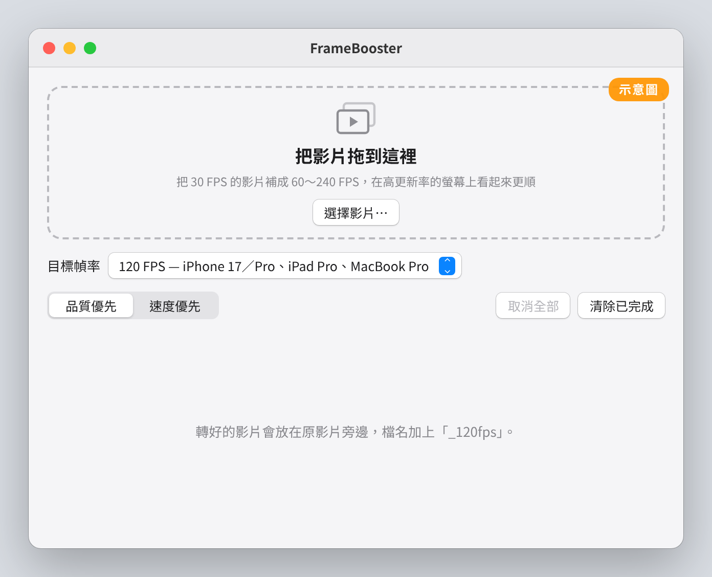
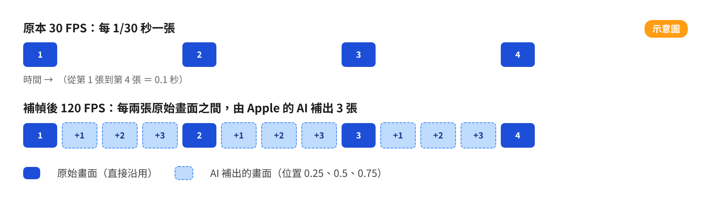
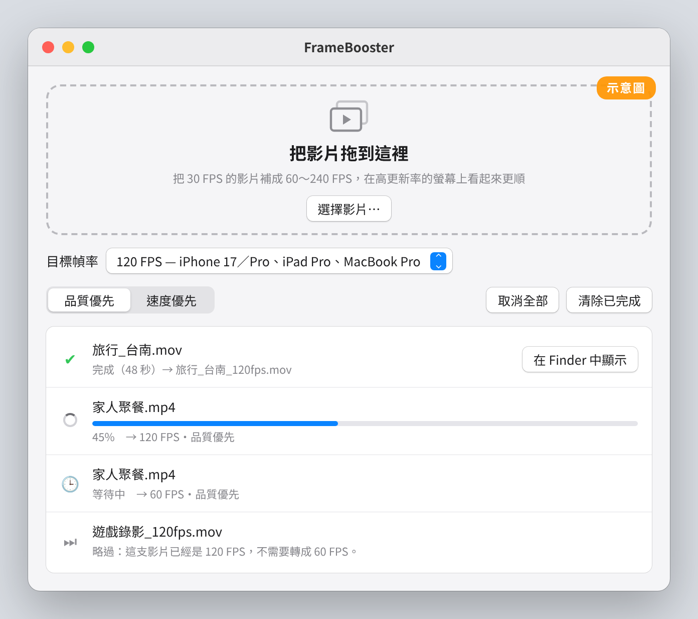
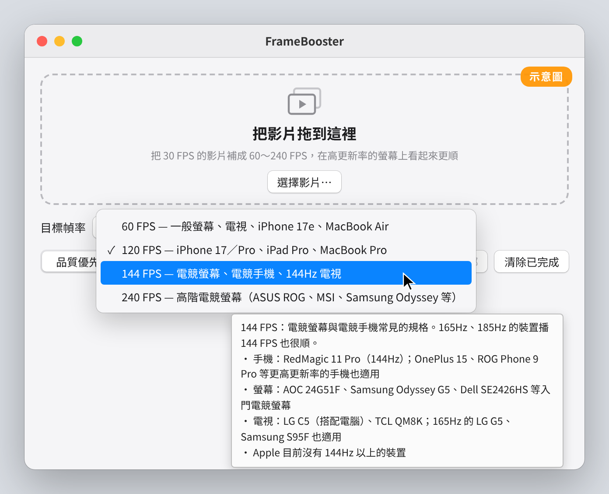

# 🎞️ FrameBooster（幀數加速器）

> 把 30 FPS 的影片「補幀」成 60／120／144／240 FPS 的 Mac 小工具，讓影片在高更新率的螢幕（iPhone 17、MacBook Pro、電競螢幕…）上看起來更順。
> 把影片拖進視窗就開始轉；用的是 Apple 內建在 macOS 裡的 AI，完全離線、不上傳。
> *A macOS app that makes videos silky-smooth (60/120/144/240 FPS) with Apple's built-in AI frame interpolation.*

   

> ⚠️ **目前是 0.1 版（試用中）**：程式已經寫好，但還在真的 Mac 上做第一輪測試。
> 安裝時會自動用測試影片轉換三次（120、60、144 FPS），結果不對就不會安裝。遇到問題歡迎回報。
> 下面的畫面圖都是**示意圖**（右上角有橘色標籤），等實機測試完成後會換成真的截圖。

<p align="center"></p>

---

## 📌 目錄

1. [這是什麼？能幫我什麼？](#1-這是什麼能幫我什麼)
2. [安裝（第一次，約 5 分鐘）](#2-安裝第一次約-5-分鐘)
3. [每天怎麼用](#3-每天怎麼用)
4. [FPS 選項與裝置對照](#4-fps-選項與裝置對照)
5. [傳到 iPhone 或其他裝置播放](#5-傳到-iphone-或其他裝置播放)
6. [效果與限制](#6-效果與限制)
7. [名詞小辭典](#7-名詞小辭典)
8. [更新到新版](#8-更新到新版)
9. [移除](#9-移除)
10. [隱私：它會連到哪些地方？](#10-隱私它會連到哪些地方)
11. [常見問題](#11-常見問題)
12. [進階：命令列版本](#12-進階命令列版本)
13. [專案裡有哪些檔案](#13-專案裡有哪些檔案)
14. [授權與致謝](#14-授權與致謝)

---

## 1. 這是什麼？能幫我什麼？

影片其實是一張一張的照片快速播放。**30 FPS** 就是每秒 30 張。

新的 iPhone 17、MacBook Pro 螢幕每秒可以更新 **120 次**（120Hz），電競螢幕甚至到 144、240 次，但手機錄影、網路上的影片大多只有每秒 30 張，螢幕的能力沒用上。

**FrameBooster 在每兩張畫面之間「猜」出中間的畫面**。以 120 FPS 為例，每兩張之間補 3 張，30 張就變成 120 張，動作看起來更滑順。這個「猜畫面」的技術叫**補幀**，由 macOS 內建的 AI 負責。

<p align="center"></p>

| | 原本 | 轉換後 |
|---|---|---|
| 每秒幾張畫面 | 30 | 60／**120**（預設）／144／240，依你的螢幕挑（見[第 4 節](#4-fps-選項與裝置對照)） |
| 在高更新率螢幕上 | 走路、轉鏡頭時有一點一格一格的感覺 | 比較滑順 |
| 聲音 | — | 原封不動保留 |
| iPhone 拍的 HDR 影片 | — | 保留 HDR |
| 原始影片 | — | **不會被修改**，轉好的是另一個新檔 |

| 你的情況 | 適合嗎 |
|---|---|
| 手機拍的 30 FPS 影片，想在 iPhone 17、iPad Pro 上看得更順 | ✅ |
| 想在電競螢幕、電競手機（144Hz、240Hz）上播 | ✅ |
| 網路上下載的 .mp4 影片 | ✅（.webm、.mkv 要先轉成 mp4，見[常見問題](#11-常見問題)） |
| 想做慢動作 | ⚠️ 目前只做「速度不變、變順」，還沒有慢動作功能 |
| 使用 Intel Mac、Windows | ❌ 需要 Apple 晶片（M1 以後）的 Mac |

---

## 2. 安裝（第一次，約 5 分鐘）

**需要**：Apple 晶片（M1、M2、M3…）的 Mac，macOS 15.4 以上。
（查看方式：左上角  →「關於這台 Mac」。）

### ① 下載 FrameBooster

**方法 A（最簡單）：下載 ZIP**
到 [GitHub 專案頁](https://github.com/WebberningMoney/frame-booster)，按綠色的 **Code → Download ZIP**，下載後雙擊解壓縮，把資料夾放在你找得到的地方（例如桌面）。

**方法 B（之後更新比較方便）：用 git 下載**
按 `⌘ + 空白鍵`，輸入 `終端機`（或 `Terminal`）按 Enter，在跳出的視窗輸入：
```bash
cd ~/Desktop
git clone https://github.com/WebberningMoney/frame-booster.git
```
桌面就會多一個 `frame-booster` 資料夾。

> 💡 終端機就是「用打字下指令」的視窗。安裝完成後，日常使用**不需要**再打開它。

### ② 雙擊安裝

打開 `frame-booster` 資料夾，**雙擊 `安裝.command`**。

會跳出一個視窗自動跑安裝：

1. 檢查你的 Mac 能不能用。
2. 把程式「編譯」出來（把原始碼變成可以執行的程式）。
   - 第一次可能會跳出「**命令列開發者工具**」的安裝視窗，這是 Apple 官方提供的免費工具，按「安裝」，裝好（約 5～10 分鐘）後**再雙擊一次 `安裝.command`**。
3. 用附帶的 4 秒測試影片實際轉成 120、60、144 FPS，確認畫面數、幀率、聲音都正確。**沒通過就不會安裝**。
4. 把 **FrameBooster** 放進「應用程式」資料夾並打開它。

裝好之後，「應用程式」和 Launchpad 裡會多一個 FrameBooster 圖示，也可以把它拖到 Dock。

> ⚠️ **如果 Mac 說「無法打開」或「無法確認開發者」**：
> 這是因為這個檔案不是從 App Store 來的，macOS 會先擋下來（用 ZIP 下載時比較常遇到）。請：
> 1. 在 `安裝.command` 上**按右鍵 → 打開**，再按「打開」。
> 2. 如果還是不行：打開「系統設定 → 隱私權與安全性」，往下捲，會看到被擋下的檔案，按「**仍要打開**」。

---

## 3. 每天怎麼用

1. **打開 FrameBooster**（「應用程式」、Launchpad 或 Dock）。
2. **選「目標幀率」**：預設 120 FPS。不確定選哪個？看選項旁邊列的裝置，或見[第 4 節](#4-fps-選項與裝置對照)。
3. **把影片拖進視窗**，或按「選擇影片…」。可以一次拖好幾支，也可以拖整個資料夾。
   - 也可以直接把影片拖到 Dock 上的 FrameBooster 圖示。
4. 等進度條跑完。轉好的影片在**原影片旁邊**，檔名多了 `_120fps`（選 60 就是 `_60fps`，以此類推）：

```
旅行.mov          ← 原本的（不會被改動）
旅行_120fps.mov   ← 轉好的
```

按該列的「**在 Finder 中顯示**」可以直接找到它。

<p align="center"></p>

- 「目標幀率」和「品質／速度」是在**影片加入的那一刻**記下來的。轉檔中改設定，只會影響之後才加入的影片。
  所以想要同一支影片的 120 和 60 兩種版本，可以先選 120 拖一次、再選 60 拖一次。
- 影片原本就已經是目標幀率以上（例如拿 120 FPS 的遊戲錄影選 60），會顯示「**略過**」，不會轉。

### 品質優先／速度優先

| 選項 | 適合 |
|---|---|
| **品質優先**（預設） | 一般使用。補出來的畫面比較自然 |
| **速度優先** | 影片很多、很長，想先快速轉完 |

### 要等多久？

和影片長度、解析度（1080p／4K）、目標幀率、選的模式有關。目標幀率越高，要補的畫面越多（240 FPS 要補的是 120 FPS 的兩倍多），通常也越久。安裝時的自我測試會顯示「4 秒 1080p 影片轉成 120／60／144 FPS 各花了幾秒」，可以用它粗估。

- 一次只轉一支，其他的會排隊，這樣反而比同時轉更快。
- 轉檔中 Mac 不會自動睡眠；可以照常做別的事。
- 按「**取消全部**」會停止目前這支（做到一半的檔案會被刪掉）和所有排隊中的影片。

---

## 4. FPS 選項與裝置對照

**原則：影片的 FPS 超過螢幕的更新率（Hz）就沒有好處**，只會讓檔案變大、轉更久。例如在 60Hz 的螢幕上播 120 FPS，看起來和 60 FPS 一樣。所以請依「要在哪個螢幕上看」來選。

下拉選單每一項後面列了代表裝置；**滑鼠停在選單上會顯示完整清單**：

<p align="center"></p>

### 怎麼選？

| 你要在哪裡看 | 建議 |
|---|---|
| iPhone 17／Air／17 Pro、iPad Pro、MacBook Pro | **120**（預設） |
| 一般電腦螢幕、電視、iPad Air、MacBook Air、iPhone 17e | **60** |
| 要上傳 YouTube、社群網站 | **60**（平台多半最高 60，見下方） |
| 電競手機、144Hz／165Hz 電競螢幕或電視 | **144** |
| 240Hz 以上的高階電競螢幕 | **240** |
| 不知道 | **120**：120Hz 是目前高階手機、平板、筆電的主流，在 60Hz 螢幕上也能正常播放（只是看不出差別） |

### 完整對照表（2026 年 11 月整理）

| FPS | Apple | 其他品牌 |
|---|---|---|
| **60** | iPhone 17e、iPad Air（M4）、iPad、iPad mini、MacBook Air、iMac、Studio Display（一般版）、Apple TV 4K | 大多數電視與一般辦公／家用螢幕；YouTube、TikTok 等影音平台 |
| **120** | iPhone 17、iPhone Air、iPhone 17 Pro／Pro Max、iPad Pro（M5）、MacBook Pro、Studio Display XDR、Apple Vision Pro | **手機**：Samsung Galaxy S26 系列、Google Pixel 10 Pro／Pro XL 等多數 Android 旗艦機<br>**遊戲機**：Nintendo Switch 2、ROG Xbox Ally X<br>**電視**：Sony Bravia 8 II、LG C5 等 120Hz 電視 |
| **144** | （目前沒有） | **手機**：RedMagic 11 Pro（144Hz）；OnePlus 15（遊戲時最高 165Hz）、ROG Phone 9 Pro（185Hz）播 144 也很順<br>**螢幕**：AOC 24G51F、Samsung Odyssey G5、Dell SE2426HS 等入門電競螢幕<br>**電視**：LG C5（接電腦時 144Hz）、TCL QM8K；165Hz 的 LG G5、Samsung S95F |
| **240** | （目前沒有） | **螢幕**：ASUS ROG Swift OLED PG32UCDM、MSI MPG 321URX、Samsung Odyssey G8（4K 240Hz）、LG UltraGear 32GX870B、Dell SE2426HGS |

補充說明：

- **Apple TV 4K** 只會切換到 60、50、30、25、24 這幾種幀率，所以用 Apple TV 在電視上看，選 60 就好。
- **Apple Vision Pro** 支援 90／96／100／120Hz，並能以 24、30 FPS 的整數倍播放，所以 120 FPS 很適合。
- **YouTube** 官方建議的上傳幀率是 24、25、30、48、50、60；**TikTok、Facebook** 等社群平台多半是 30～60。上傳後平台通常會重新壓縮。
- **Steam Deck OLED** 是 90Hz：選 120 可以播，但不會比 60 順很多。
- 電視要真的顯示 120Hz 以上，通常要用電腦或遊戲機透過 HDMI 2.1 連接；電視內建的播放器不一定支援。
- 更新率超過 144Hz 的裝置（165Hz、185Hz、240Hz…）播 144 FPS 也很順；FrameBooster 沒有放 165、185 這些選項，是為了讓選單保持簡單。

<details>
<summary>資料來源（點開）</summary>

- iPhone 17 全系列 ProMotion：[MacRumors](https://www.macrumors.com/2025/10/01/iphone-17-models-launch-sept-19-new-features/)；iPhone 17e 為 60Hz：[Android Authority](https://androidauthority.com/iphone-17e-ruin-budget-android-phones-3657797/)
- iPad Air（M4）60Hz、iPad Pro 120Hz：[Android Authority](https://www.androidauthority.com/apple-ipad-air-m4-3645695/)
- Studio Display XDR 120Hz、Studio Display 60Hz：[MacRumors](https://www.macrumors.com/2026/03/03/apple-introduces-all-new-studio-display-xdr/)
- Apple Vision Pro 更新率：[Apple 規格頁](https://www.apple.com/apple-vision-pro/specs/)
- Apple TV 4K 相符幀率：[Apple 支援](https://support.apple.com/102277)
- YouTube 建議上傳設定：[YouTube 說明](https://support.google.com/youtube/answer/1722171)
- Galaxy S26 Ultra、Pixel 10 Pro XL：[PhoneArena](https://www.phonearena.com/reviews/samsung-galaxy-s26-ultra-vs-google-pixel-10-pro-xl_id7705)
- RedMagic 11 Pro 144Hz：[TechRadar](https://www.techradar.com/phones/redmagic-11-pro-review)；OnePlus 15 165Hz：[GSMArena](https://m.gsmarena.com/nubia_redmagic_11_pro-review-2902p6.php)；ROG Phone 9 Pro 185Hz：[Pocket Tactics](https://www.pockettactics.com/asus-rog-phone-9-pro-vs-redmagic-10-pro)
- Nintendo Switch 2 120Hz、Steam Deck OLED 90Hz：[Windows Central](https://www.windowscentral.com/gaming/switch-2-vs-steam-deck)；ROG Xbox Ally X 120Hz：[Tech Insider](https://tech-insider.org/ca/?p=507)
- LG C5／G5 更新率：[RTINGS](https://www.rtings.com/tv/learn/2025-lineup)；Bravia 8 II、S95F、TCL QM8K：[gagadget](https://gagadget.com/en/717133-gaming-tv-for-ps5-amp/)
- 240Hz 螢幕：[RTINGS](https://www.rtings.com/monitor/reviews/best/240hz)、[Tech Insider](https://tech-insider.org/asus-pg32ucdm-vs-msi-321urx-vs-gigabyte-mo27u2-2026/)、[DropReference](https://dropreference.com/en/blog/guide/best-oled-gaming-screens-2026-comparison-buying-guide)
- 144Hz／240Hz 平價螢幕：[iTechGuides](https://itechguides.com/best-cheap-144hz-gaming-monitor-in-2026-top-picks-and-reviews)

新機種推出時，這張表和 App 裡的清單（`Sources/App/FPSPresets.swift`）需要一起更新。
</details>

---

## 5. 傳到 iPhone 或其他裝置播放

1. 在 Finder 對著 `_120fps.mov` 按右鍵 →「分享」→「**AirDrop**」，選你的 iPhone。
2. iPhone 收到後會存進「**照片**」，直接播放就好。

> 💡 想確認是不是 120 FPS：在「照片」裡打開影片，往上滑看資訊，通常會顯示影片的幀率。
> 💡 iPhone 開著**低耗電模式**時，螢幕可能會限制在 60Hz，就看不出 120 FPS 的差別。

**Android 手機**：用 USB 線、Google 雲端硬碟或 Quick Share 等方式傳過去。大多數新款 Android 手機都能播 HEVC（H.265）的 `.mov`；如果播不了，可能是那支手機的播放器不支援，可以試試 VLC。

**電腦螢幕／電視**：接在電腦上，用 QuickTime Player、IINA、VLC 等播放器全螢幕播放。電腦的螢幕更新率要設成最高（Mac：「系統設定 → 顯示器 → 更新頻率」）。

**上傳到社群或影音網站**：很多平台會把影片重新壓縮成 30 或 60 FPS，所以上傳後不一定還是原本的幀率。

---

## 6. 效果與限制

補幀是「用前後兩張畫面去猜中間」，所以：

| 情況 | 效果 |
|---|---|
| 平移、轉鏡頭、走路、車子開過 | 👍 通常最明顯、最自然 |
| 動作很快、東西突然出現或被擋住 | ⚠️ 邊緣可能有一點變形或殘影 |
| 剪接點（畫面突然切換到另一個場景） | ⚠️ 切換的那一瞬間可能有很短的殘影（約 1/40 秒） |
| 畫面停住很久（例如螢幕錄影） | 超過 0.5 秒沒有新畫面的地方不補，直接延續原畫面 |
| 原本就已經是目標幀率以上的影片 | 不需要轉，顯示「略過」 |
| 目標幀率越高（144、240） | 每兩張之間要補的畫面越多，猜錯的機會也比較多；轉得也比較久 |

**檔案大小**：轉好的檔案通常會比原檔大。程式依「畫面變成幾倍」調整位元率（每秒用多少資料量記錄畫面）：

| 30 FPS 轉成 | 位元率約為原檔的 |
|---|---|
| 60 | 1.5 倍 |
| 120 | 2 倍 |
| 144 | 2.4 倍 |
| 240 | 4 倍 |

最低每秒 6 Mb，所以原本壓得很小的網路影片，可能會大好幾倍。這些倍數還沒在實機上調校過，之後可能會調整。

**格式**：輸出一律是 `.mov`（HEVC），Mac、iPhone、iPad 都能直接播放。

---

## 7. 名詞小辭典

| 名詞 | 白話解釋 |
|---|---|
| **FPS**（每秒影格數） | 影片每秒有幾張畫面。電影 24、手機錄影多半 30、遊戲常見 60 |
| **補幀**（影格插補） | 在兩張畫面之間，算出中間應該長什麼樣子，插進去讓動作更順 |
| **Hz**（螢幕更新率） | 螢幕每秒換幾次畫面。一般螢幕 60Hz；iPhone 17、MacBook Pro 最高 120Hz（Apple 稱為 ProMotion）；電競螢幕 144～240Hz 以上 |
| **電競螢幕**／**電競手機** | 為了打遊戲設計、更新率特別高（144Hz 以上）的螢幕和手機 |
| **HEVC**（H.265） | 一種影片壓縮方式，同樣畫質下檔案比舊的 H.264 小。Apple 裝置都支援 |
| **位元率** | 每秒用多少資料量記錄畫面。越高越清楚，檔案也越大 |
| **HDR** | 亮的地方更亮、暗的地方細節更多的影片。iPhone 預設錄的就是 HDR（HLG 格式） |
| **10-bit** | 每個顏色能分得更細（約 10 億種顏色，一般影片約 1600 萬種），HDR 需要它 |
| **.mov** | Apple 的影片檔格式，Mac、iPhone 都能直接播放 |
| **編譯** | 把人寫的程式原始碼，轉換成電腦可以執行的程式 |

---

## 8. 更新到新版

**用 ZIP 下載的**：重新下載 ZIP、解壓縮，再雙擊新資料夾裡的 `安裝.command`。

**用 git 下載的**：在終端機輸入：
```bash
cd ~/Desktop/frame-booster
git pull
```
然後雙擊 `安裝.command`。

> 只更新資料夾還不夠，一定要**再雙擊一次 `安裝.command`**，「應用程式」裡的 FrameBooster 才會換成新版。

---

## 9. 移除

雙擊資料夾裡的 `解除安裝.command`，輸入 `y` 確認，就會從「應用程式」移除 FrameBooster。

- FrameBooster 不會在電腦其他地方存資料或設定，所以這樣就乾淨了。
- **你轉好的影片不會被刪除**。
- 最後把 `frame-booster` 資料夾丟到垃圾桶即可。

---

## 10. 隱私：它會連到哪些地方？

**哪裡都不連。** FrameBooster 完全離線運作：

- 影片只在你的 Mac 上處理，不會上傳到任何地方。
- 補幀用的是 macOS 內建的 AI，不需要下載模型，也不需要帳號。
- 不收集任何使用資料。

> 💡 第一次轉「下載項目」「桌面」「文件」資料夾裡的影片時，macOS 可能會問「FrameBooster 想要取用…資料夾中的檔案」。這是 macOS 的保護機制，按「允許」才能把轉好的影片存在原影片旁邊。

---

## 11. 常見問題

**Q：拖進去之後出現「無法讀取這個檔案」？**
A：macOS 只能直接讀 `.mov`、`.mp4`、`.m4v` 等格式。網路上下載的 `.webm`、`.mkv` 需要先轉成 `.mp4`（例如用免費的 HandBrake），再拖進 FrameBooster。

**Q：要選哪個 FPS？**
A：看你要在哪個螢幕上看，見[第 4 節](#4-fps-選項與裝置對照)的「怎麼選？」。不確定就用預設的 120。

**Q：選了比螢幕更高的 FPS（例如在 60Hz 螢幕上播 120 FPS）會怎樣？**
A：可以正常播放，只是螢幕每秒最多換 60 次畫面，多出來的畫面看不到，看起來和 60 FPS 差不多，檔案卻比較大。

**Q：出現「略過：這支影片已經是 xx FPS，不需要轉成 xx FPS」？**
A：影片本來就已經是目標幀率以上，不用再轉。想要更高的幀率，可以在下拉選單選更高的數字，再拖一次。

**Q：轉好的影片在 iPhone 上看起來沒有比較順？**
A：可以試試：① 確認播放的是 `_120fps.mov` 那個檔案；② 確認手機的螢幕真的是 120Hz（iPhone 17e 是 60Hz）；③ 關掉「低耗電模式」；④ 用動作比較多的片段比較（靜態畫面本來就看不出差別）。

**Q：某些畫面有奇怪的殘影或變形？**
A：補幀是用「猜」的，動作很快或東西被擋住的地方可能猜不準，這是所有補幀工具共同的限制。用「品質優先」可能會好一些。

**Q：安裝時說找不到 Swift 編譯器／跳出「命令列開發者工具」？**
A：照畫面按「安裝」，裝好後再雙擊一次 `安裝.command`。

**Q：安裝失敗或自我測試沒有通過？**
A：資料夾裡的 `build/install_log.txt` 有完整紀錄，請提供給開發者（或在 GitHub 開 Issue）。

**Q：說「需要 Apple 晶片」或「需要 macOS 15.4 以上」？**
A：補幀用的是 Apple 從 macOS 15.4 開始內建的 AI，只能在 Apple 晶片的 Mac 上執行。請先到「系統設定 → 一般 → 軟體更新」更新 macOS。

**Q：可以轉成清單以外的 FPS（例如 90、165）嗎？**
A：視窗版只提供 60、120、144、240；命令列版本可以指定 1～240 的任何數字，見下一節。

---

## 12. 進階：命令列版本

安裝後，資料夾裡的 `build/frame-booster` 是命令列版本，適合批次處理或寫腳本。在 `frame-booster` 資料夾裡打開終端機：

```bash
build/frame-booster 影片.mp4                 # 轉成 120 FPS（放在原影片旁邊）
build/frame-booster --fast *.mov             # 速度優先、一次轉很多支
build/frame-booster --fps 60 影片.mp4        # 轉成 60 FPS（也可以 144、240，或 1～240 的任何數字）
build/frame-booster 影片.mp4 -o 輸出.mov     # 指定輸出檔名
build/frame-booster --info 影片.mov          # 只看影片資訊（解析度、幀率、畫面數）
```

**自己編譯與測試**（改了程式之後）：
```bash
bash scripts/build.sh      # 編譯到 build/
bash scripts/selftest.sh   # 用測試影片轉成 120、60、144 FPS 並檢查結果
```

程式怎麼運作見 [`docs/ARCHITECTURE.md`](docs/ARCHITECTURE.md)。

---

## 13. 專案裡有哪些檔案

```text
frame-booster/
├── 安裝.command          ← 雙擊安裝（編譯＋自我測試＋放進「應用程式」）
├── 解除安裝.command      ← 雙擊移除
├── Sources/
│   ├── Converter.swift   ← 核心：讀影片、請 AI 補幀、寫出新影片（開頭有白話說明）
│   ├── App/App.swift     ← 視窗版：拖放、排隊、進度條
│   ├── App/FPSPresets.swift ← 目標幀率選項（60／120／144／240）與各自適合的裝置清單
│   └── CLI/main.swift    ← 命令列版
├── Resources/Info.plist  ← App 的基本資料（名稱、版本、可以接受拖放影片）
├── assets/AppIcon.iconset ← App 圖示
├── scripts/
│   ├── build.sh          ← 編譯（安裝檔會呼叫它）
│   ├── selftest.sh       ← 自我測試（安裝檔會呼叫它）
│   ├── git-hooks/        ← 開發用：commit／push 前的自動檢查
│   └── docs/             ← 開發用：產生示意圖（make_mockups.py）和 App 圖示（make_icon.py）
├── test/sample_30fps.mp4 ← 自我測試用的 4 秒測試影片（電腦產生的測試畫面＋嗶聲）
├── docs/
│   ├── ARCHITECTURE.md   ← 給想學程式的人：架構圖、流程圖、補幀怎麼算、用到哪些技術
│   ├── RESOURCES.md      ← 相關工具與參考資料
│   └── images/           ← README 用的圖（目前都是示意圖）
├── CHANGELOG.md          ← 每次更新改了什麼
├── CLAUDE.md             ← 給 AI 助理的協作守則
└── LICENSE               ← 授權條款
```

安裝後還會多一個 `build/` 資料夾（編譯出來的程式、安裝紀錄），不會上傳到 GitHub。

**想學程式？** 先看 [`docs/ARCHITECTURE.md`](docs/ARCHITECTURE.md) 的架構圖，再從 `Sources/Converter.swift` 開頭的說明和 `FrameGenerator`（決定每一格放什麼畫面）開始看。

---

## 14. 授權與致謝

- 授權：[MIT License](LICENSE)。可以自由使用、修改、散布，請保留版權聲明。
- 補幀技術：Apple macOS 內建的 VideoToolbox「影格率轉換」（VTFrameProcessor）。
- FrameBooster 程式與文件：Webber Huang × Claude（2026）。
- 相關工具與延伸閱讀：[`docs/RESOURCES.md`](docs/RESOURCES.md)。
