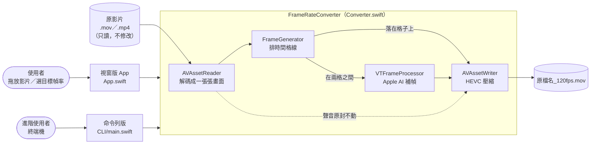
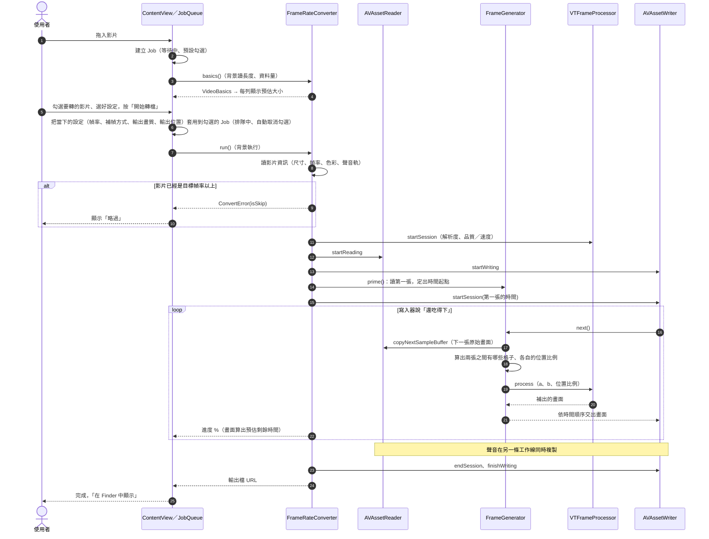
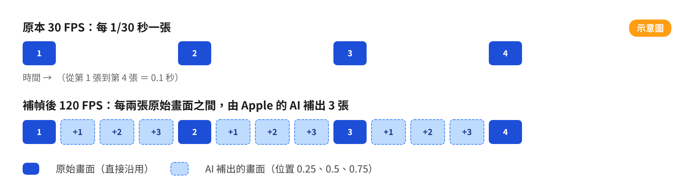
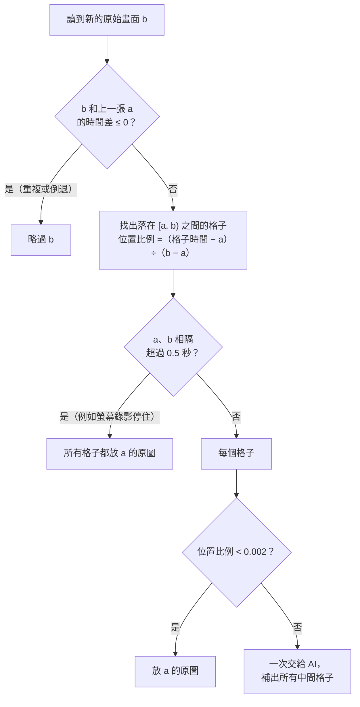
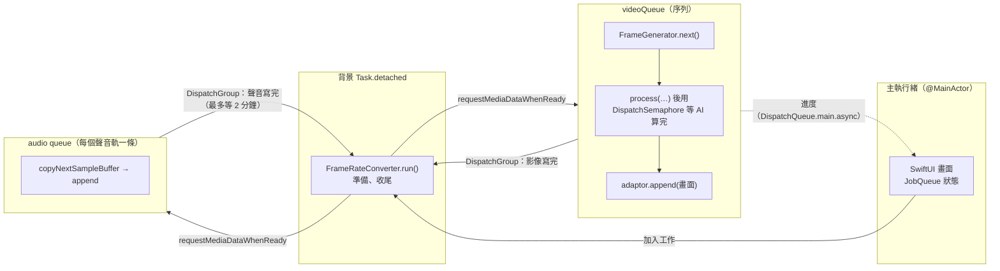
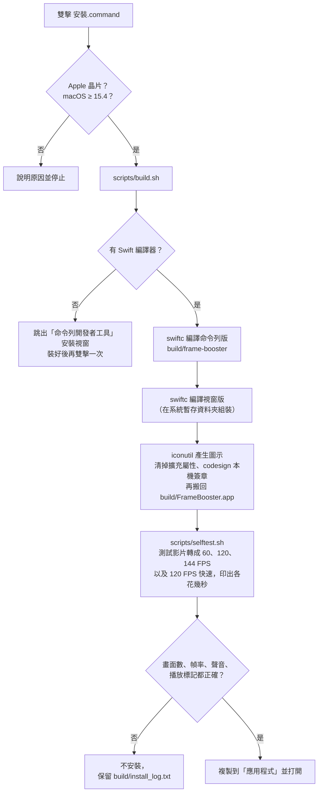

# FrameBooster 是怎麼組成的

> 給想看懂、修改程式，或想藉這個專案學 Swift／macOS 影片處理的人。一般使用者請看 [README](../README.md)。
> 下面的圖用 [Mermaid](https://mermaid.js.org/) 寫成，GitHub 會直接顯示成圖；改程式時直接改文字即可。

## 目錄

1. [一張圖看懂](#1-一張圖看懂)
2. [用到哪些技術](#2-用到哪些技術)
3. [程式模組與關係](#3-程式模組與關係)
4. [一次轉檔的完整經過（時序圖）](#4-一次轉檔的完整經過時序圖)
5. [補幀怎麼算：時間格線](#5-補幀怎麼算時間格線)
6. [誰在哪條工作線上跑（並行模型）](#6-誰在哪條工作線上跑並行模型)
7. [Apple 的 AI 補幀（VTFrameProcessor）](#7-apple-的-ai-補幀vtframeprocessor)
8. [色彩、HDR、聲音、輸出設定](#8-色彩hdr聲音輸出設定)
9. [安裝與建置流程](#9-安裝與建置流程)
10. [檔案一覽](#10-檔案一覽)
11. [設計決定](#11-設計決定)
12. [想學程式：建議的閱讀順序](#12-想學程式建議的閱讀順序)
13. [只能在真的 Mac 上驗證的事](#13-只能在真的-mac-上驗證的事)

---

## 1. 一張圖看懂

全部用 macOS 內建的框架，**沒有任何第三方套件，也不連網**。

---

## 2. 用到哪些技術

| 技術 | 是什麼 | 在這個專案用來做什麼 | 在哪裡 |
|---|---|---|---|
| **Swift 5**（語言模式） | Apple 的程式語言 | 全部程式 | `Sources/` |
| **SwiftUI** | Apple 用「描述畫面長怎樣」來寫介面的框架 | 視窗、下拉選單、進度條、拖放 | `App.swift` |
| **AppKit** | macOS 傳統的介面框架 | 開檔視窗（`NSOpenPanel`）、在 Finder 中顯示（`NSWorkspace`）、Dock 拖放（`NSApplicationDelegate`） | `App.swift` |
| **AVFoundation** | Apple 的影音框架 | 讀影片（`AVAssetReader`）、寫影片（`AVAssetWriter`）、讀資訊（`AVURLAsset`） | `Converter.swift` |
| **VideoToolbox** | 底層的影片硬體加速框架 | **AI 補幀**（`VTFrameProcessor`）、畫面格式複製（`VTPixelTransferSession`）、HEVC 硬體編碼 | `Converter.swift` |
| **CoreVideo**／**CoreMedia** | 畫面記憶體與時間的基本型別 | 畫面記憶體池（`CVPixelBufferPool`、IOSurface）、精確時間（`CMTime`） | `Converter.swift` |
| **UserDefaults** | macOS 的 App 偏好設定 | 記住使用者選的輸出資料夾 | `App.swift` |
| **Swift Concurrency** | `async`／`await` 非同步寫法 | 讀影片資訊、整個轉檔流程、等寫入完成 | `run()`、`App.swift` |
| **GCD**（Grand Central Dispatch） | 傳統的多工作線工具 | 影像／聲音各自一條工作線、等待 AI 算完（`DispatchSemaphore`）、等全部寫完（`DispatchGroup`） | `run()`、`FrameGenerator` |
| **swiftc**＋**Bash** | 命令列編譯器與腳本 | 不用 Xcode 專案就能編譯、自我測試、安裝 | `scripts/`、`安裝.command` |
| **codesign**、**iconutil** | macOS 內建工具 | 本機簽章、產生 App 圖示 | `scripts/build.sh` |
| **git hooks** | commit／push 前自動執行的檢查 | 確認作者、沒有簽章、改程式有改文件 | `scripts/git-hooks/` |
| **Python**＋**Playwright**／**Pillow** | 開發用的小工具 | 產生示意圖、App 圖示（使用者不需要） | `scripts/docs/` |

---

## 3. 程式模組與關係

```mermaid
classDiagram
    direction LR
    class FrameBoosterApp {
        視窗程式進入點 @main
    }
    class ContentView {
        拖放區、目標幀率下拉選單、輸出位置
        進階設定（補幀方式、輸出畫質）
        開始轉檔（已勾選 N 支）／取消轉檔按鈕
        全選／全不選
        工作清單（勾選框、進度、預估剩餘時間、預估大小、移除）
    }
    class JobQueue {
        jobs: [Job]
        targetFPS / highQuality / outputQuality
        outputDirectory（記在偏好設定）
        add：加入影片（等待中、預設勾選，背景讀大小資訊）
        setChecked：勾選／取消（Shift 連選一整段）
        setAllChecked：全選／全不選
        startRound：把勾選的影片套用設定、排隊
        startNext：開始下一支
        cancelRound：取消這一輪
        remove：從清單移除
    }
    class Job {
        input: URL
        isChecked：有沒有勾選
        basics：VideoBasics（算預估大小用）
        settings：JobSettings（按開始時填入）
        status：等待中→排隊中→轉檔中→完成…
        isSelectable：等待中或已結束才能勾
        progress / remaining / output
    }
    class VideoBasics {
        長度、幀率、尺寸、資料量、檔案大小
        wouldSkip：會不會被略過
        estimatedBytes：預估轉好後的大小
    }
    class JobSettings {
        targetFPS / highQuality
        outputQuality / outputDirectory
    }
    class FPSPreset {
        fps: 60/120/144/240
        shortDevices（選單上）
        fullDevices（滑鼠停留）
    }
    class CLI_main {
        讀參數、顯示進度
        --fps --fast --quality
        --out-dir -o --info
    }
    class FrameRateConverter {
        run：轉檔，回傳輸出檔（async）
        cancel：取消
        info：讀影片資訊 → VideoInfo
        basics：快速讀大小資訊 → VideoBasics
        videoBitrate：位元率公式（轉檔和預估共用）
    }
    class ConvertOptions {
        targetFPS
        highQuality（補幀方式：精細／快速）
        outputQuality
        outputDirectory
        maxInterpolationGap
        outputURL（命令列 -o）
    }
    class OutputQuality {
        high / standard / compact
        bitrateMultiplier：1.5／1／0.6
        minimumBitrate
    }
    class ConvertError {
        message
        isSkip（略過，不是錯誤）
    }
    class FrameGenerator {
        prime：讀第一張、定時間起點
        next：交出下一張畫面＋時間
        pump：讀一張原始畫面、排格子
        interpolate：請 AI 補幀
    }
    FrameBoosterApp --> ContentView
    ContentView --> JobQueue
    ContentView ..> FPSPreset : 選項與裝置清單
    JobQueue "1" o-- "*" Job
    Job ..> JobSettings
    Job ..> VideoBasics
    VideoBasics ..> FrameRateConverter : 用同一個 videoBitrate
    JobQueue --> FrameRateConverter : 一次一支
    CLI_main --> FrameRateConverter
    FrameRateConverter ..> ConvertOptions
    ConvertOptions ..> OutputQuality
    FrameRateConverter ..> ConvertError
    FrameRateConverter *-- FrameGenerator
```

- **畫面層**（`App.swift`、`FPSPresets.swift`、`CLI/main.swift`）只負責「收集設定、排隊、顯示進度」。
- **核心層**（`Converter.swift`）不知道畫面長怎樣，所以視窗版和命令列版共用同一份轉檔程式。

---

## 4. 一次轉檔的完整經過（時序圖）

失敗或取消時：停止讀取、取消寫入、**只刪除這次做到一半的輸出檔**，原影片不受影響。

---

## 5. 補幀怎麼算：時間格線

輸出影片有一條固定的時間格線：**每 1／目標幀率 秒一格**，第 0 格對齊第一張原始畫面的時間。

每讀到一張新的原始畫面 **b**，就處理「上一張 **a** 到 b 之間」的格子：

**例 1：30 → 120 FPS**（剛好 4 倍）：每兩張之間有 4 格，位置比例是 0（原圖）、0.25、0.5、0.75（AI 補）。

**例 2：30 → 144 FPS**（4.8 倍，不是整數倍）：格子和原始畫面的時間大多對不齊，所以大部分格子都由 AI 補：

| 輸出第幾格 | 時間（毫秒） | 在哪兩張之間 | 位置比例 | 來源 |
|---|---|---|---|---|
| 0 | 0.00 | 1–2 | 0.000 | 原圖 |
| 1 | 6.94 | 1–2 | 0.208 | AI |
| 2 | 13.89 | 1–2 | 0.417 | AI |
| 3 | 20.83 | 1–2 | 0.625 | AI |
| 4 | 27.78 | 1–2 | 0.833 | AI |
| 5 | 34.72 | 2–3 | 0.042 | AI（非常接近原圖 2） |
| 6 | 41.67 | 2–3 | 0.250 | AI |
| … | … | … | … | … |
| 12 | 83.33 | 3–4 | 0.500 | AI |

每 5 張原始畫面（1/6 秒）才會有一格剛好對齊原圖。用「時間」而不是「第幾張」來算，所以：

- 29.97 FPS、或幀率忽快忽慢（手機在暗處常這樣）的影片，也會對齊到正確的時間。
- 最後一張原始畫面後面沒有下一張可以補，就讓它停留原本的長度。

---

## 6. 誰在哪條工作線上跑（並行模型）

- `FrameGenerator` 只在 `videoQueue` 上使用，所以不需要上鎖。
- 影像和聲音**同時**寫入：`AVAssetWriter` 會把兩者交錯存放，如果先寫完影像再寫聲音，寫入器可能會卡住等聲音。
- 錯誤用 `FirstError`（有上鎖）記住第一個發生的錯誤；寫入器出錯時，聲音最多等 5 秒就放棄，避免整個程式卡死。

---

## 7. Apple 的 AI 補幀（VTFrameProcessor）

- macOS 15.4 起提供，在 WWDC25 的〈Enhance your app with machine-learning-based video effects〉介紹。
- 用法：`startSession(configuration:)` 開始 → 每一對畫面呼叫一次 `process(parameters:completionHandler:)` → `endSession()`。
- `VTFrameRateConversionConfiguration`：設定解析度、品質優先（`.quality`）或速度優先（`.normal`）。
- `VTFrameRateConversionParameters`：來源畫面 a、下一張 b、要補的位置比例（`interpolationPhase`）、裝結果的空白畫面。一次可以要很多張（例如 240 FPS 時每兩張之間補 7 張）。
- 連續處理時用 `.sequential` 模式（引擎可以沿用上一輪算好的動作資訊）；中間有跳過時改用 `.random`。
- 引擎對記憶體格式有要求（`sourcePixelBufferAttributes`），所以解碼出來的畫面會先用 `VTPixelTransferSession` 複製到符合要求的記憶體。
- 新舊 SDK 的 Swift 介面略有不同（例如 `isSupported`／`processorSupported`），程式用 `#if compiler(>=6.2)` 兩邊都支援。

---

## 8. 色彩、HDR、聲音、輸出設定

**色彩與 HDR**

- 讀取原始影片的色彩標記（色域、轉換曲線、矩陣）。
- 是 HDR（HLG 或 PQ）或 10-bit 影片 → 用 10-bit 處理，輸出 HEVC Main10，並標上原本的色彩標記，iPhone 會當 HDR 播放。
- 一般影片 → 8-bit。色彩標記如果寫入器不接受，就不標（避免整個轉檔失敗）。

**聲音**

- 能原封不動複製就直接複製（不重新壓縮，音質不變）。
- 格式放不進 `.mov` 時，才重新壓成 AAC 立體聲（48 kHz、256 kbps）。

**輸出設定**

| 項目 | 設定 | 原因 |
|---|---|---|
| 容器 | `.mov` | Apple 裝置原生支援，可以裝的聲音格式比 `.mp4` 多 |
| 影像編碼 | HEVC（H.265），硬體編碼 | 檔案小、Apple 裝置都能硬體解碼 |
| 位元率（`videoBitrate`） | 原檔 ×（畫面倍數 ÷ 2，最少 1.5）× 輸出畫質倍數（高 1.5／標準 1／省空間 0.6）；最低 8／6／3 Mbps、最高 300 Mbps | 補出來的畫面和前後很像，很好壓縮，不需要跟畫面數等比例增加。倍數還沒有在實機上調校過。畫面上的「預估大小」也用同一個公式：（影像位元率＋聲音位元率）× 長度 ÷ 8 |
| 關鍵畫面間隔 | 每 2 秒一張 | 拖動進度條時反應比較快 |
| 播放標記 | QuickTime 影片資訊 `com.apple.quicktime.full-frame-rate-playback-intent` = 1（`AVMetadataKey.quickTimeMetadataKeyFullFrameRatePlaybackIntent`，iOS 18／macOS 15 起） | 沒有這個標記時，iPhone「照片」和 QuickTime Player 會把 120 FPS 以上的影片當慢動作、中間放慢播放。已在 iPhone 17 Pro 上確認加了標記後會用正常速度播放 |
| 方向 | 沿用原檔的旋轉設定 | 直拍的手機影片不會變橫的 |
| 位置與檔名 | 原影片旁邊或選定的資料夾；`原檔名_<幀率>fps.mov`，重複時加「 2」「 3」… | 絕不覆蓋任何檔案；輸出檔和原影片是同一個檔案時直接拒絕 |

---

## 9. 安裝與建置流程

---

## 10. 檔案一覽

| 檔案 | 負責什麼 |
|---|---|
| `Sources/Converter.swift` | 核心。`FrameRateConverter` 負責整個轉檔流程；`FrameGenerator` 決定每一格放什麼畫面；`VideoInfo` 讀影片資訊；`VideoBasics` 算預估大小；`ConvertError` 區分「錯誤」和「略過」 |
| `Sources/App/App.swift` | 視窗版（SwiftUI）：拖放、勾選（Shift 連選、全選）、排隊、目標幀率下拉選單、輸出位置、進階設定、進度條、預估剩餘時間與大小 |
| `Sources/App/FPSPresets.swift` | 目標幀率選項（60／120／144／240）與各自適合的裝置清單（選單文字、滑鼠停留說明） |
| `Sources/CLI/main.swift` | 命令列版：讀參數、顯示進度、`--info` |
| `Resources/Info.plist` | App 的名稱、版本、最低系統版本（15.4）、圖示、可以接受拖放影片 |
| `assets/AppIcon.iconset` | 圖示原始圖片，編譯時用 `iconutil` 組成 `.icns` |
| `scripts/build.sh` | 用 `swiftc` 編譯兩個程式到 `build/`，並做本機簽章（ad-hoc）；App 先在系統暫存資料夾組裝、簽章再搬回來 |
| `scripts/selftest.sh` | 轉換 `test/sample_30fps.mp4` 成 60、120、144 FPS（以及 120 FPS 快速），檢查畫面數、幀率、聲音、「正常速度播放」標記，最後印出各花幾秒 |
| `scripts/docs/make_mockups.py` | 產生 README 的示意圖（`docs/images/`） |
| `scripts/docs/make_icon.py` | 產生 App 圖示原始圖片（符合 macOS 26 的圓角方形規格） |
| `scripts/git-hooks/` | commit／push 前的自動檢查 |
| `安裝.command` | 檢查電腦 → 編譯 → 自我測試 → 複製到「應用程式」 |
| `解除安裝.command` | 確認後從「應用程式」移除 App |

為什麼不用 Xcode 專案：用 `swiftc` 直接編譯，只需要免費的「命令列開發者工具」，不用安裝好幾 GB 的 Xcode，專案檔也比較單純。

---

## 11. 設計決定

| 決定 | 原因 |
|---|---|
| 用 Apple 內建 AI，不用 RIFE 等開源模型 | 不用下載模型、不用 Python 環境，直接用 Apple 晶片的神經網路引擎；Apple 也在 Compressor 用機器學習做 60／90／120 fps 的影格重定時 |
| 目標幀率只放 60／120／144／240 | 涵蓋一般螢幕、Apple 與 Android 旗艦、電競裝置；165、185 等少見的數字用 144 就很順，選單保持簡單。命令列版仍可指定任意數字 |
| 要按「開始轉檔」才開始 | 擁有者回饋：拖進來就馬上轉，來不及改設定或拿掉拖錯的影片 |
| 設定在「按開始時」套用到整輪 | 拖完再調設定也來得及，最直覺；轉檔中改設定會用在下一輪。同一支影片要兩種版本就分兩輪 |
| 轉檔中新加入的影片要再按一次開始 | 擁有者的選擇：避免不小心用了不對的設定。新加入的會停在「等待中」，畫面上會提示 |
| 用勾選框決定這一輪轉哪些 | 擁有者回饋：想從清單挑第 1～5 支或第 1、2、4 支，用同一組設定轉。新加入的預設勾選（最常見是全部都要轉）；Shift 連選和全選／全不選讓多支影片也好操作。用勾選框而不是 macOS 清單的選取（反白），是因為勾選狀態看得清楚、點別的地方也不會不見 |
| 按開始後自動取消勾選 | 勾選框代表「下一輪要轉的」，這樣轉完後清單上不會殘留勾選，下一輪只要勾新的就好 |
| 已結束的影片可以再勾起來重轉 | 方便同一支影片再轉一個不同幀率或畫質的版本；輸出檔名重複時自動加編號，不會蓋掉之前的 |
| 每列顯示預估大小，且和實際壓縮共用 `videoBitrate` | 讓使用者先知道要準備多少空間；共用同一個公式，改了壓縮設定時預估也會一起改，不會兩邊對不上。硬體編碼器大致會照設定的位元率壓，實測一支 720p 影片實際比預估多約 2%（可能是檔案格式本身的資料），所以畫面上寫「實際大小可能略有出入」 |
| 圖示：圓角方形內完全不透明、沒有陰影、沒有超出邊界 | macOS 26 起，系統會把不合規格的圖示（有超出圓角方形的像素、半透明的地方）放進灰色的框裡。正式做法是用 Xcode 的 Icon Composer，但擁有者沒有完整 Xcode，所以改用符合規格的 PNG 組成 `.icns` |
| 「補幀方式」和「輸出畫質」分開 | Apple 引擎只有「品質／效能優先」一個開關，管的是補出來的畫面；檔案大小由我們自己的位元率決定。分開才說得清楚，也都收進「進階設定」讓主畫面保持簡單 |
| 不提供 CPU／GPU／記憶體用量設定 | 解碼、補幀、壓縮大多由 Mac 的專用硬體做，Apple 的 API 沒有「用幾條執行緒、多少 GPU」這類設定；改成顯示預估剩餘時間 |
| 只記住「輸出位置」 | 其他設定（幀率、補幀方式、畫質）每次打開都回到預設，避免忘記改過而轉出不預期的結果；輸出資料夾則是常常固定的，記住比較方便 |
| 已達目標幀率就「略過」 | 降幀率不是這個工具的目的，也避免不小心產生比原檔差的檔案 |
| 一次只轉一支 | 補幀和 HEVC 編碼都很吃硬體，同時轉多支不會比較快 |
| 安裝時一定跑自我測試 | 這個專案無法在雲端沙盒測試，用測試影片在使用者的 Mac 上確認「真的轉得出來、幀率正確」才安裝。測 144 是為了檢查非整數倍的時間格線 |
| 不用 SwiftUI 的巨集（`@State`、`@Observable`、`#Preview` 等） | 新版 SDK 裡這些是「巨集」，編譯時需要只有完整 Xcode 才有的 SwiftUIMacros 外掛；只裝「命令列開發者工具」會編譯失敗。改用 `ObservableObject`＋`@Published`＋`@StateObject`／`@EnvironmentObject` |
| App 在系統暫存資料夾組裝、簽章 | 專案放在開了 iCloud 同步的「桌面」或「文件」時，檔案會被加上 Finder 附加資訊，`codesign` 會拒絕簽章 |
| 跨工作線的物件標成 `@unchecked Sendable` | AVFoundation 的讀寫物件沒有標成可跨工作線（Sendable），但程式保證每個物件只在固定的一條工作線上使用；包進 `VideoPipe`／`AudioPipe` 再交給工作線，避免大量警告 |
| 一律標記「用原本的幀率正常播放」，不提供慢動作選項 | 這個工具的目的是讓影片看起來更順，不是做慢動作；真的想要慢動作時，iPhone「照片」仍然可以手動調速度 |
| 不做剪接點偵測（目前） | 120 FPS 下剪接點的殘影只有約 1/40 秒；之後若有需要再加 |

---

## 12. 想學程式：建議的閱讀順序

| 順序 | 看什麼 | 可以學到 |
|---|---|---|
| 1 | `Sources/App/FPSPresets.swift` | Swift 的 `struct`、`static let`、多行字串，最好懂 |
| 2 | `Sources/CLI/main.swift` | 讀命令列參數、`async`／`await`、錯誤處理（`do`／`catch`） |
| 3 | `Converter.swift` 的 `FrameGenerator` | 時間格線的算法、`CMTime`、怎麼呼叫 Apple 的 AI |
| 4 | `Converter.swift` 的 `run()` | `AVAssetReader`／`AVAssetWriter` 讀寫影片、色彩與 HDR、影像和聲音同時寫入 |
| 5 | `Sources/App/App.swift` | SwiftUI 畫面、`ObservableObject` 狀態管理、拖放、`@MainActor` |
| 6 | `scripts/build.sh`、`selftest.sh`、`安裝.command` | 不用 Xcode 怎麼編譯、自動化測試、安裝腳本 |

---

## 13. 只能在真的 Mac 上驗證的事

雲端沙盒（Linux）沒有 macOS 的框架，下面這些都要在 Mac 上確認：

- 能不能編譯（Swift 版本、SDK 版本差異）
- AI 補幀的品質與速度（尤其 144、240 FPS）
- HDR 影片轉完是否仍是 HDR、在 iPhone 上播放是否正常
- 聲音是否同步
- 直拍影片方向是否正確
- 預估大小和實際檔案差多少（目前只量過一支 720p 影片，多約 2%）
- 下拉選單的滑鼠停留說明（每個選項各自的說明能不能顯示）
- 拖放、Dock 圖示拖放、「在 Finder 中顯示」
- macOS 的檔案存取詢問（桌面、下載項目、文件）
- README 目前用示意圖（擁有者的真實截圖含個人檔名，不放上來）
